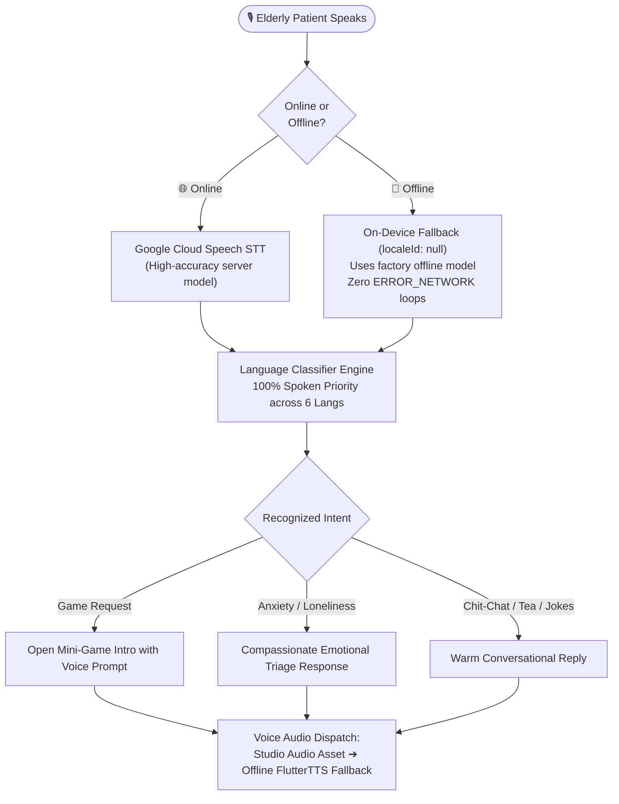
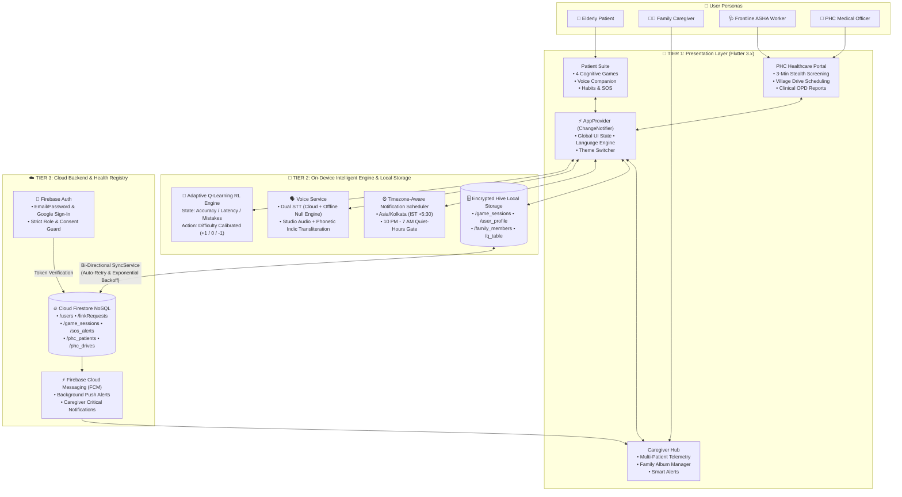

<div align="center">


# NeuroVerse

### Adaptive Cognitive Health & Neuro-Rehabilitation Platform
**Smart India Hackathon 2026 — Prototype**

*Empowering Caregivers · Engaging Patients · Preserving Cognition · Strengthening Grassroots Healthcare*

<br/>

[](https://flutter.dev)
[](https://dart.dev)
[](https://firebase.google.com)
[](https://docs.hivedb.dev)
[](#-adaptive-intelligence-on-device-q-learning)
[](#-multilingual-localization-9-languages)
[](LICENSE)

---

</div>

## 📖 Table of Contents

- [Overview](#-overview)
- [Key Features](#-key-features)
  - [👴 Patient Experience](#-patient-experience)
  - [🧑‍⚕️ Caregiver Command Center](#️-caregiver-command-center)
  - [🏥 PHC Frontline Network (ASHA & Doctors)](#-phc-frontline-network-asha--doctors)
  - [🔐 Admin Console](#-admin-console)
- [Cognitive Game Hub](#-cognitive-game-hub)
- [Adaptive Intelligence (On-Device Q-Learning)](#-adaptive-intelligence-on-device-q-learning)
- [Multilingual Localization (9 Languages)](#-multilingual-localization-9-languages)
- [Offline-Resilient Voice Assistant](#-offline-resilient-voice-assistant)
- [Emergency SOS & Caregiver Alerting](#-emergency-sos--caregiver-alerting)
- [System Architecture](#-system-architecture)
- [Tech Stack](#-tech-stack)
- [Repository Structure](#-repository-structure)
- [Getting Started](#-getting-started)
- [Testing Suite](#-testing-suite)
- [Security & Privacy Governance](#-security--privacy-governance)
- [Contributing & License](#-contributing--license)

---

## 🌟 Overview

**NeuroVerse** is a cross-platform, offline-first cognitive rehabilitation and tele-monitoring platform tailored for senior citizens, individuals living with Mild Cognitive Impairment (MCI) or dementia, their family caregivers, and grassroots public health workers. 

Addressing the dual challenge of geriatric cognitive decline and limited healthcare access across rural and semi-urban communities (with dedicated grounding in **Northeast India**), NeuroVerse combines:
1. **Adaptive Mini-Games**: On-device Reinforcement Learning (Q-Learning) that adjusts difficulty in real time to prevent cognitive fatigue and frustration.
2. **Offline-Resilient Multilingual Voice AI**: Conversational companion supporting 9 Indian languages with 100% spoken-language priority and zero-crash offline speech recognition fallback.
3. **Caregiver Telemetry & Remote Care**: Real-time compliance tracking, longitudinal drift detection (Smart Alerts), and personalized family album generation.
4. **Primary Health Centre (PHC) & ASHA Network**: Doorstep 3-minute stealth screenings by frontline ASHA workers and clinical drive coordination by PHC Medical Officers.

---

## ✨ Key Features

### 👴 Patient Experience

* **Interactive Cognitive Game Suite**: 4 culturally-rooted mini-games targeting visual memory, sequential logic, object recall, and facial recognition.
* **On-Device Q-Learning Dynamic Difficulty**: Seamlessly scales challenge levels based on accuracy, reaction time, and hint dependencies.
* **Dementia-Friendly In-Game Hints**: Multi-tier assistance (card peek, distractor dimming, sequence glow illumination, photo cues) with complete hint-usage analytics.
* **100% Offline Multilingual Localization**: Full support for **9 Indian languages** with 824+ translation keys per language and independent App UI vs. Spoken Voice selection.
* **Hands-Free Voice AI Companion**: Natural conversational support for reassurance, anxiety management, and instant voice-triggered game launching.
* **Emergency SOS Lifeline**: 2-second hold trigger providing reassuring local-language voice feedback, satellite GPS lock, silent background SMS dispatch to caregiver contacts, and instant Firestore push alerts.
* **Quiet Hours Guard & Adherence Scheduling**: Precise Asia/Kolkata (IST +5:30) notification scheduling suppressing alarms between 10:00 PM and 7:00 AM, with 9:00 AM workouts and 7:00 PM catch-up reminders (auto-canceled once completed).
* **Habit Streaks & Progress Dashboard**: 14-day interactive activity tracker, streak calendars, and celebratory 3D confetti rewards.

---

### 🧑‍⚕️ Caregiver Command Center

* **Dual & Multi-Caregiver Support**: Multiple family members or nursing staff can securely link to a single patient using a 6-character `Connect Code`.
* **Consent-Driven Security Handshake**: Link requests trigger an in-app prompt in the patient's drawer, requiring explicit approval before data is shared.
* **Live Telemetry & Performance Trends**: Real-time cards showing cognitive wellness scores, active day consistency, and longitudinal accuracy.
* **Personalized Family Album Manager**: Upload, crop, and label family and friend portraits with relationships and names, syncing them locally to Hive and Firestore for personalized Face Recall sessions.
* **Smart Alerts Engine**: Analyzes last 10 sessions to automatically flag:
  * 🔴 **Repeated Struggle**: Accuracy repeatedly below 50% across 3 sessions.
  * 🟡 **Activity Gaps**: No gameplay recorded for 72+ hours.
  * 🟠 **Unusual Decline**: Sudden drop > 30 points between sessions of the same game.
* **Interactive SOS Interception**: High-priority alert dialog featuring instant patient phone callback and direct Google Maps navigation.
* **Remote Reminders Hub**: Schedule medication with meal restrictions (before/with/after meals), hydration intervals, and wellness check-ins.

---

### 🏥 PHC Frontline Network (ASHA & Doctors)

NeuroVerse includes a complete sub-ecosystem built for the **National Health Mission (NHM)** and frontline rural healthcare infrastructure:

* **ASHA Worker Portal**:
  * **Doorstep 3-Minute Stealth Screening**: Administers lightweight cognitive assessments formatted as gentle, non-stressful mini-games.
  * **Rural Elder Registration**: Collects village cluster, house/ward number, guardian phone, and ABHA Health ID.
  * **Standardized Skip Logging**: Formally logs visit postponements due to real-world rural field realities (monsoon floods, agricultural farm duties, illness, or family rescheduling).
  * **Offline Queue & Cloud Sync**: Operates seamlessly in zero-connectivity village settings, batch-syncing when internet access is restored.
* **Medical Officer (Doctor) Command Hub**:
  * **Facility Oversight (`PHC-JHT-108`)**: Supervises attached sub-centers and verifies incoming ASHA registrations.
  * **Field Drive Scheduling**: Deploys ASHA field teams to remote village clusters with equal patient workload distribution.
  * **Clinical Triage & Red Alerts**: Real-time dashboard highlighting elders with severe cognitive decline.
  * **Clinical Reporting**: Generates structured printable summaries: Geriatric Dementia Progression Rosters and ASHA Field Supervision Reports.
  * **PHC OPD Referral Tokens**: Generates trackable referral tokens for secondary hospital evaluation.

---

### 🔐 Admin Console

* **System Health Dashboard**: Platform-wide user metrics and active session distributions.
* **User Lifecycle Management**: Real-time role auditing and account suspension/re-activation controls.
* **Platform Announcements**: Broadcast high-priority administrative bulletins across the patient and caregiver ecosystem.

---

## 🎮 Cognitive Game Hub

| Game | Cognitive Domain | North-East India Theme | In-Game Dementia Hint System |
|:---|:---|:---|:---|
| **Card Match** | Short-term memory, visual recognition | Kopou Orchid & Assam Tea Estates Edition | Peek Card Reveal |
| **Pattern Path** | Sequential memory, spatial attention | Cherrapunji Living Root Bridges Trail | Next-Tile Pathway Glow Illumination |
| **Object Finder** | Working memory, object recall | North-East Cultural & Heritage Image Cards | Card Highlight Prompt & Distractor Dimming |
| **Face Recall** | Facial recognition, biographical memory | Family & Heritage Album (Caregiver-uploaded + fallback) | Distractor Dimming, Replay Clue & Indic Transliteration |

* **Adaptive Difficulty Calibration**: Controlled dynamically by on-device Q-Learning reinforcement algorithms.
* **Indic Transliteration**: Romanized names (e.g. "Rohan", "Sunita") are converted offline into native phonetic Indic scripts so speech engines pronounce family names accurately.

---

## 🧠 Adaptive Intelligence (On-Device Q-Learning)

NeuroVerse includes an on-device Reinforcement Learning engine (`QLearningService` + `AdaptiveIntelligenceService`):

$$\text{State} = \langle \text{DifficultyLevel}\ (1\text{--}10),\ \text{AccuracyBucket}\ (\text{HIGH / MED / LOW}),\ \text{TimeBucket}\ (\text{FAST / AVG / SLOW}) \rangle$$

$$\text{Reward} = R_{\text{accuracy}} + R_{\text{time}} - (\text{HintsUsed} \times 0.5)$$

$$\text{Bellman Update:}\quad Q(s, a) \leftarrow Q(s, a) + \alpha \left[ r + \gamma \max_{a'} Q(s', a') - Q(s, a) \right]$$

* Parameters: Learning rate $\alpha = 0.1$, Discount factor $\gamma = 0.9$, Exploration rate $\epsilon = 0.2$.
* When a patient struggles, the system drops the difficulty level ($D-1$) to eliminate cognitive frustration and preserve confidence.

---

## 🌐 Multilingual Localization (9 Languages)

NeuroVerse features zero-restart, reactive localization across 9 Indian languages with 824+ translation keys per language:

| Language | Code | Native Name | Script | Studio Audio Narration | TTS Fallback |
|:---|:---:|:---:|:---:|:---:|:---:|
| **English** | `en` | English | Latin | ✅ Studio | ✅ |
| **Hindi** | `hi` | हिन्दी | Devanagari | ✅ Studio | ✅ |
| **Bengali** | `bn` | বাংলা | Bengali | ✅ Studio | ✅ |
| **Assamese** | `as` | অসমীয়া | Assamese (ৰ, ৱ) | ✅ Studio | ✅ |
| **Manipuri** | `mni` | মৈতৈলোন | Meitei / Bengali | ✅ Studio | ✅ |
| **Mizo** | `miz` | Mizo ṭawng | Latin | ✅ Studio | ✅ |
| **Kannada** | `kn` | ಕನ್ನಡ | Kannada | — | ✅ |
| **Telugu** | `te` | తెలుగు | Telugu | — | ✅ |
| **Marathi** | `mr` | मराठी | Devanagari | — | ✅ |

---

## 🗣️ Offline-Resilient Voice Assistant

The conversational voice assistant (`VoiceService` + `VoiceModeScreen`) is built with senior accessibility and intermittent connectivity in mind:



---

## 🚨 Emergency SOS & Caregiver Alerting

NeuroVerse provides a fail-safe emergency lifeline designed for seniors:

1. **Local Audio Reassurance**: Speaks immediate calming feedback in the patient's selected dialect (*"Your emergency alert is being sent to your caregiver"*).
2. **Satellite GPS Lock**: Fetches high-accuracy latitude and longitude coordinates via device GPS hardware without requiring cellular internet.
3. **Silent Background SMS**: Invokes native Android `SmsManager` over a dedicated MethodChannel to silently dispatch emergency SMS with Google Maps coordinates to registered caregiver phone numbers.
4. **Cloud Firestore Dispatch**: Broadcasts an active alert to `sos_alerts` and direct notifications under `users/{caregiverId}/notifications`.
5. **Caregiver Full-Screen Dialog**: Intercepts active caregiver sessions with haptic feedback, patient phone dialer button, and Google Maps location button.

---

## 📐 System Architecture

NeuroVerse enforces strict **Clean Architecture** patterns:



---

## ⚙️ Tech Stack

| Layer | Technology | Details |
|:---|:---|:---|
| **Core Framework** | Flutter 3.x | Cross-platform UI development for Android, iOS, and Web |
| **Language** | Dart 3.x | Sound null-safe modern reactive programming |
| **State Management** | Provider (`MultiProvider`) | Clean dependency injection and reactive state trees |
| **Local Offline Storage** | Hive + Hive Flutter | Ultra-fast, encrypted lightweight NoSQL key-value store |
| **Cloud Database** | Cloud Firestore | Real-time multi-patient telemetry, alerts, and records |
| **Authentication** | Firebase Auth | Role-based authorization and session management |
| **Push Notifications** | Firebase Cloud Messaging (FCM) | Background critical alert dispatch to caregivers |
| **Local Alarms & Scheduling** | flutter_local_notifications | Timezone-aware exact alarm scheduling with quiet-hours gating |
| **Speech-to-Text (STT)** | speech_to_text | Dual engine: Google Cloud STT + On-Device offline model |
| **Text-to-Speech (TTS)** | flutter_tts | Native hardware speech synthesis for dynamic feedback |
| **Audio Playback** | audioplayers | Low-latency playback of studio-recorded regional audio |
| **Geolocation & Emergency** | geolocator & url_launcher | Satellite GPS coordinate locking and emergency SMS dispatch |
| **Adaptive Intelligence** | Custom Q-Learning Engine | On-device Reinforcement Learning algorithm |

---

## 🗂️ Repository Structure

```
NeuroVerse_SDLC/
├── README.md                                # Root documentation
├── implementation/
│   └── neuroverse/
│       ├── pubspec.yaml                     # Dependencies and asset declarations
│       ├── analysis_options.yaml            # Linter rules and code quality checks
│       │
│       ├── android/                         # Android native configurations & gradle files
│       │   └── app/src/main/AndroidManifest.xml
│       │
│       ├── assets/
│       │   ├── images/                      # App icons, botanical art, memory cards
│       │   └── audio/voice/                 # Studio pre-recorded regional voice clips
│       │       ├── en/                      # English audio assets
│       │       ├── hi/                      # Hindi audio assets
│       │       ├── bn/                      # Bengali audio assets
│       │       ├── as/                      # Assamese audio assets
│       │       ├── mni/                     # Manipuri audio assets
│       │       └── miz/                     # Mizo audio assets
│       │
│       ├── lib/
│       │   ├── main.dart                    # Application bootstrap & dependency injection
│       │   ├── app/
│       │   │   ├── app.dart                 # MaterialApp & theme configuration
│       │   │   ├── routes/app_routes.dart   # Centralized route definitions
│       │   │   └── theme/                   # Emerald & teal theme tokens
│       │   │
│       │   ├── core/
│       │   │   ├── localization/            # 9-language translation dictionaries
│       │   │   ├── utils/                   # Indic phonetic transliteration engine
│       │   │   ├── models/                  # GameSession, Reminder, FamilyMember models
│       │   │   └── services/                # QLearning, Voice, SOS, SmartAlerts, Sync
│       │   │
│       │   ├── data/
│       │   │   ├── local/hive_service.dart  # Hive box initializers and CRUD
│       │   │   └── remote/                  # Firebase Auth & Firestore services
│       │   │
│       │   ├── providers/
│       │   │   └── app_provider.dart        # Global ChangeNotifier state manager
│       │   │
│       │   └── features/
│       │       ├── auth/                    # Login, signup, and verification
│       │       ├── role_selection/          # Multi-role picker
│       │       ├── onboarding/              # Splash, language, and profile setup
│       │       ├── patient/                 # Games (Card Match, Pattern Path, Object Finder,
│       │       │                            # Face Recall), Voice, Habits, and Progress
│       │       ├── caregiver/               # Telemetry, Family Album Manager, Alerts
│       │       ├── phc_network/             # ASHA Doorstep Screening & Doctor Command Hub
│       │       └── admin/                   # Platform analytics & announcements
│       │
│       └── test/                            # Unit, widget, and integration test suite
```

---

## 🚀 Getting Started

### Prerequisites

- [Flutter SDK](https://docs.flutter.dev/get-started/install) (`>= 3.11.0`)
- Android Studio / VS Code with Flutter and Dart extensions
- Android device or emulator running **API 21 (Lollipop)** or higher
- A Firebase project with **Authentication**, **Cloud Firestore**, and **FCM** enabled

---

### Step-by-Step Installation

#### 1. Clone the Repository
```bash
git clone https://github.com/Aditi05336/Neuroverse_SDLC.git
cd Neuroverse_SDLC/implementation/neuroverse
```

#### 2. Install Dependencies
```bash
flutter pub get
```

#### 3. Configure Firebase
1. Navigate to the [Firebase Console](https://console.firebase.google.com/) and create a project.
2. Enable **Email/Password** and **Google Sign-In** under Authentication.
3. Enable **Cloud Firestore** in test or production mode.
4. Download your `google-services.json` configuration file and place it in:
   ```
   implementation/neuroverse/android/app/google-services.json
   ```
   *(A reference template is provided at `implementation/neuroverse/android/app/google-services.example.json`)*

#### 4. Run the Application
```bash
# Debug mode on connected device
flutter run
```

#### 5. Build Release APK
```bash
flutter build apk --split-per-abi
# Outputs will be located in build/app/outputs/flutter-apk/
```

---

## 🧪 Testing Suite

NeuroVerse includes an automated test suite covering state management, localization, reinforcement learning transitions, and offline voice fallbacks:

```bash
cd implementation/neuroverse

# Run all unit and widget tests
flutter test

# Run Voice Assistant & Spoken Priority Tests
flutter test test/features/patient/voice/voice_mode_screen_test.dart

# Run Face Recall Adaptive Progression Tests
flutter test test/features/patient/games/face_recall_test.dart

# Run Localization & Game Instructions Tests
flutter test test/features/patient/localization_games_and_voice_test.dart

# Run ASHA Screening & Responsive Tests
flutter test test/features/asha/asha_localization_and_responsive_test.dart

# Run Caregiver Telemetry & Alerts Tests
flutter test test/features/caregiver/caregiver_overview_redesign_test.dart
```

---

## 🛡️ Security & Privacy Governance

* **Data Minimization & Patient Confidentiality**: Health records and cognitive screening data are accessible solely to approved caregivers and licensed medical officers. Admins view only anonymized system health statistics.
* **Consent-Driven Linking**: No caregiver or family member can link to a patient account without the patient explicitly approving the link request in-app.
* **Offline-First Vault**: Sensitive personal records, game performance logs, and family portraits reside securely on the local device in encrypted Hive boxes.
* **Rate-Limiting & Anti-Brute-Force**: Protected Firebase Auth entrypoints with user reload checks and automated session lockouts.

---

## 🤝 Contributing & License

Contributions, feedback, and pull requests are warmly welcomed! Please read through our contribution workflow:

1. **Fork** the repository.
2. **Create** a feature branch (`git checkout -b feature/your-feature-name`).
3. **Commit** your enhancements (`git commit -m "feat: add your feature"`).
4. **Push** to the branch (`git push origin feature/your-feature-name`).
5. **Open** a Pull Request.

This project is licensed under the **MIT License** — see the [LICENSE](implementation/neuroverse/LICENSE) file for details.

---

<div align="center">

Built with ❤️ for **Smart India Hackathon 2026**

*Empowering caregivers. Engaging patients. Preserving cognition.*

</div>
